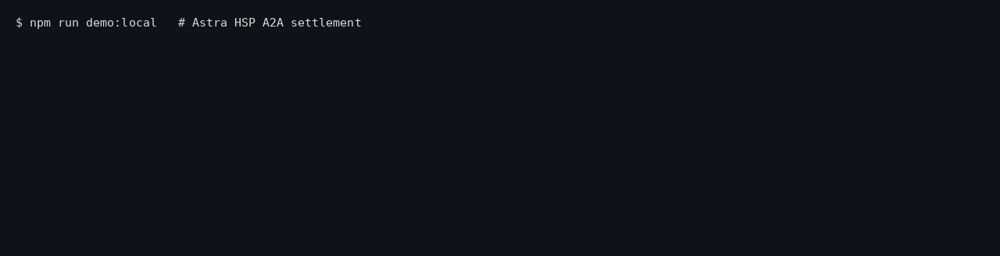

# HSP A2A Settlement — agent-to-agent payments on HashKey Chain

**Track:** HashKey Chain Horizon Hackathon — Agent Payments & A2A Settlement
**Team:** Carl, Astra Trading Co

One AI agent sells a skill over HTTP. Another agent buys it, with no human in the loop.
Payment is negotiated with an HTTP `402` (x402 v2 shape), authorized with a signed
**HSP v1 Mandate**, settled by a plain USDC transfer from the buyer's own wallet
(zero-custody, as HSP intends), confirmed by the **HSP Coordinator**, and anchored
on HashKey Chain in a small receipt registry so any third agent can audit who paid whom, for what.



## Flow

```
Buyer agent                         Seller agent                     HSP Coordinator        HashKey Chain
    | POST /tasks/chain-snapshot        |                                   |                      |
    |---------------------------------->|                                   |                      |
    | 402 {scheme:"hsp-mandate",        |                                   |                      |
    |      payTo, asset, amount, quoteId}                                   |                      |
    |<----------------------------------|                                   |                      |
    | SpendGuard: chain / token / payee allowlist, per-payment + daily cap  |                      |
    | sign EIP-712 Mandate (nonce = keccak256(quoteId))                     |                      |
    | POST /payments  ------------------------------------------------------>| paymentId           |
    | USDC.transfer(payTo, amount) ----------------------------------------------------------------->|
    | retry with x-hsp-payment {quoteId, paymentId, txHash, mandate}        |                      |
    |---------------------------------->| verify signature + quote binding  |                      |
    |                                   | POST /payments/:id/observe ------>| settled receipt      |
    |                                   | run skill, recordSettlement() ------------------------------>|
    | 200 {result, serviceHash, receipt, anchorTx}                          |                      |
```

## What is in the repo

| Path | What it does |
|---|---|
| `contracts/src/A2AReceiptRegistry.sol` | Agent directory + append-only log of HSP-settled payments. Holds no funds. A payee can only anchor receipts paid to itself; a paymentId can be anchored once. |
| `agent/src/hsp/mandate.ts` | HSP v1 Mandate: build, EIP-712 sign, `paymentId` (struct hash), verify (signer recovery + profile check). |
| `agent/src/hsp/coordinator.ts` | `HttpCoordinator` (real HSP Coordinator REST: `POST /payments`, `POST /payments/:id/observe` with 202 retry) and `LocalCoordinator`, an offline test double that runs the same checks (signature, chain, deadline, matching `Transfer` log, confirmations). |
| `agent/src/hsp/spendGuard.ts` | Buyer-side policy enforced *before* anything is signed. |
| `agent/src/a2a/seller.ts` | 402 seller: quotes, quote-bound mandate checks, replay protection, delivery, on-chain anchoring. Agent card at `/.well-known/agent.json`. |
| `agent/src/a2a/buyer.ts` | Autonomous buyer: handles 402 → guard → mandate → register → pay → retry. |
| `agent/scripts/demo-local.ts` | Full flow on a local anvil chain. |
| `agent/scripts/demo-hashkey.ts` | Same flow live on HashKey Chain through the real HSP Coordinator; writes `proofs/hashkey-<chainId>.json`. |

## Security properties (each one has a test)

- Mandate is bound to one quote (`nonce = keccak256("astra-a2a:" + quoteId)`); an unbound mandate is refused.
- Replaying a used proof is refused; a paymentId can be anchored on-chain only once.
- A transfer that does not match the mandate (amount, payer, payee, token) is refused.
- Tampering with any mandate field, or using another chain's domain, breaks signature verification.
- SpendGuard blocks over-cap prices, unknown payees/tokens/chains, and daily overspend before signing.

## Run it

```bash
# needs Foundry (forge, anvil) and Node 22+
cd contracts && forge test          # 5 tests
cd ../agent && npm ci && npm test   # 16 tests (unit + end-to-end on anvil)
npm run demo:local
```

Live on HashKey Chain:

```bash
cd agent
export HSK_RPC=https://mainnet.hsk.xyz HSK_CHAIN_ID=177 HSP_CHAIN=hashkey \
       HSP_COORDINATOR_URL=https://hsp-hackathon.hashkeymerchant.com HSP_API_KEY=... \
       USDC_ADDRESS=0x054ed45810DbBAb8B27668922D110669c9D88D0a BUYER_KEY=... SELLER_KEY=...
npm run demo:hashkey
```

Keys and the HSP API key are read from the environment only and are never committed.

## Live on HashKey Chain mainnet (chain 177)

Run on 30 Oct 2026 (`proofs/hashkey-177.json`). Explorer: https://explorer.hsk.xyz

| Step | Address / tx |
|---|---|
| A2AReceiptRegistry | [`0xF33e3244f9acFd0c7235c484DdF901699615051a`](https://explorer.hsk.xyz/address/0xF33e3244f9acFd0c7235c484DdF901699615051a) |
| Registry deploy | [`0x467362e7…e801`](https://explorer.hsk.xyz/tx/0x467362e7405443f57205b9be3834bd324e796ed0f67fc0da73480859907ce801) |
| Seller `registerAgent` | [`0x0da5a097…5360`](https://explorer.hsk.xyz/tx/0x0da5a097c338ad565153bb164d26905888442b27b306276b362c4d3b06985360) |
| Buyer → seller token transfer (0.01 WHSK) | [`0x6b06b6d4…6175`](https://explorer.hsk.xyz/tx/0x6b06b6d4f8a982a21783c762f9c8cbe202158a22a77cca8c03e6c2527b7b6175) |
| Seller `recordSettlement` anchor | [`0x504e6fd8…6baa`](https://explorer.hsk.xyz/tx/0x504e6fd8d90d75aa93df2cb1baa5656387bd34702f57991c58af183f6f2a6baa) |
| HSP paymentId (EIP-712 mandate hash) | `0x75cd608d58335a53323fee9348f7061055463990647ae756abfcbbbef67f3056` |

What is real and what is not, stated plainly:

- **Real mainnet transactions:** the registry deploy, agent registration, the buyer's token transfer and the on-chain settlement anchor.
- **Coordinator step was run locally.** We did not have an HSP Coordinator API key at run time, so `demo-hashkey.ts` fell back to `LocalCoordinator`. It runs the same checks (EIP-712 signature, chain, deadline, a matching `Transfer` log, confirmations) against the HashKey mainnet RPC. The proof file records `coordinator: "local-verifier …"`. With `HSP_API_KEY` set, the same script uses the real Coordinator (`HttpCoordinator`).
- **Settlement token was WHSK, not USDC.e.** Within our small budget we could not get a stablecoin onto the demo wallets: the Meson USDT pool on HashKey was empty, and no API bridge lists USDC.e. The code works with any ERC-20 token. Set `USDC_ADDRESS=0x054ed45810DbBAb8B27668922D110669c9D88D0a` to settle in USDC.e.

## Network reference

| | Mainnet | Testnet |
|---|---|---|
| Chain ID | 177 | 133 |
| RPC | https://mainnet.hsk.xyz | https://testnet.hsk.xyz |
| Explorer | https://explorer.hsk.xyz | https://testnet-explorer.hsk.xyz |
| USDC | `0x054ed45810DbBAb8B27668922D110669c9D88D0a` (USDC.e) | `0x8FE3cB719Ee4410E236Cd6b72ab1fCDC06eF53c6` |

## Deployments and proofs

See [`proofs/`](proofs/). Live HashKey deployment addresses and tx hashes are added there as `hashkey-<chainId>.json` once the run completes.

## License

MIT — Carl, Astra Trading Co
